# Hypercube

<div align="center">

# ◇ Hypercube

### A React Native mobile application built around a compact, portable product experience

[](https://reactnative.dev/)
[](LICENSE)
[](https://github.com/lucylow/Hypercube)

</div>

> **Repository:** `https://github.com/lucylow/Hypercube`  
> **Project type:** React Native Mobile App  
> **License:** MIT  
> **Current public repository shape:** `images/`, `.gitignore`, `LICENSE`, `README.md`, two historical screenshots, and `hypercube-mobile.zip`.

---

## Documentation philosophy

This README is intentionally implementation-aware but conservative. The public GitHub root confirms the project is a React Native mobile application and exposes the repository artifacts listed above, but the packaged `hypercube-mobile.zip` is not expanded in the root tree. Therefore:

- **Verified facts** are described as facts.
- **Recommended architecture** is described as guidance.
- **Future enhancements** are explicitly labeled as proposals.
- Exact package versions, scripts, APIs, screens, native modules, and backend services are not invented where they are not visible in the public repository surface.

That distinction keeps the documentation useful for contributors while preventing the README from becoming a fictional specification.

---

## Table of Contents

1. [Project Overview](#1-project-overview)
2. [Repository Snapshot](#2-repository-snapshot)
3. [Product Framing](#3-product-framing)
4. [Engineering Goals](#4-engineering-goals)
5. [Architecture Principles](#5-architecture-principles)
6. [System Architecture](#6-system-architecture)
7. [Application Layers](#7-application-layers)
8. [Navigation Architecture](#8-navigation-architecture)
9. [State Management](#9-state-management)
10. [Domain Modeling](#10-domain-modeling)
11. [Service Boundaries](#11-service-boundaries)
12. [Persistence](#12-persistence)
13. [Networking](#13-networking)
14. [Error Handling](#14-error-handling)
15. [Loading and Empty States](#15-loading-and-empty-states)
16. [Visual Design System](#16-visual-design-system)
17. [Asset Pipeline](#17-asset-pipeline)
18. [Responsive Layout](#18-responsive-layout)
19. [Accessibility](#19-accessibility)
20. [Performance](#20-performance)
21. [Security](#21-security)
22. [Privacy](#22-privacy)
23. [Observability](#23-observability)
24. [Testing Strategy](#24-testing-strategy)
25. [Developer Setup](#25-developer-setup)
26. [Repository Workflow](#26-repository-workflow)
27. [Debugging](#27-debugging)
28. [Release Engineering](#28-release-engineering)
29. [CI/CD](#29-cicd)
30. [Architecture Evolution](#30-architecture-evolution)
31. [Feature Module Template](#31-feature-module-template)
32. [Technical Diagrams](#32-technical-diagrams)
33. [Performance Budget](#33-performance-budget)
34. [Threat Model](#34-threat-model)
35. [Failure Modes](#35-failure-modes)
36. [Contribution Guide](#36-contribution-guide)
37. [Code Review Checklist](#37-code-review-checklist)
38. [Documentation Standards](#38-documentation-standards)
39. [Suggested Modernization Plan](#39-suggested-modernization-plan)
40. [Future Roadmap](#40-future-roadmap)
41. [FAQ](#41-faq)
42. [Glossary](#42-glossary)
43. [License](#43-license)
44. [Acknowledgements](#44-acknowledgements)

---
# 1. Project Overview

Hypercube is a public React Native mobile application repository maintained at [`lucylow/Hypercube`](https://github.com/lucylow/Hypercube). GitHub currently identifies the repository as a **React Native Mobile App** and shows a compact root containing image assets, two screenshots, a packaged `hypercube-mobile.zip`, the project README, an MIT license, and standard repository metadata.

The project is small enough to be approachable while still benefiting from a formal architecture guide. A mobile codebase becomes easier to maintain when its presentation layer, navigation, domain rules, services, persistence, testing, and release processes have explicit boundaries.

### What this README is for

This document is designed to be the technical front door for the project. It explains:

- what is verifiably present in the repository;
- how a React Native application of this shape can be structured;
- how to reason about state, navigation, services, persistence, performance, and security;
- how to grow the project without turning every feature into a cross-cutting refactor;
- how contributors can preserve existing behavior while improving maintainability.

### What this README does not claim

The current public root does **not** expose the full contents of `hypercube-mobile.zip` as individual source files. Because of that, this documentation does not invent exact package versions, npm scripts, screen names, backend endpoints, or native dependencies.

Where a recommendation appears, it is marked as a recommended engineering pattern rather than a statement of current implementation.

---
# 2. Repository Snapshot

The public repository currently exposes the following root-level artifacts:

```text
Hypercube/
├── images/
├── .gitignore
├── LICENSE
├── README.md
├── Screen Shot 2022-10-30 at 10.54.19 PM.png
├── Screen Shot 2022-10-30 at 10.54.38 PM.png
└── hypercube-mobile.zip
```

The repository page reports 12 commits, no releases, no packages, and an MIT license. The project description is simply **React Native Mobile App**.

### Why the ZIP matters

A packaged mobile source archive is convenient for preserving a snapshot, but it adds friction for modern collaboration. Standard Git workflows work best when the source tree itself contains the project manifest, application source, native folders where applicable, and development scripts.

A useful future migration is:

```text
hypercube-mobile.zip
        │
        ▼
inspect source
        │
        ▼
verify build + dependencies
        │
        ▼
promote source into normal repository layout
        │
        ▼
document reproducible setup
```

The migration should preserve working behavior before reorganizing code.

---
# 3. Product Framing

The repository does not currently provide a detailed product narrative in its root README. The safest framing is therefore architectural: Hypercube is a mobile experience whose value is delivered through screens, interactions, visual assets, state transitions, and application behavior.

This framing is intentionally broad enough to remain true whether the app evolves toward a focused utility, an interactive visualization, an educational experience, a productivity workflow, or another mobile-first use case.

### Experience model

```text
User intent
    ↓
Screen / interaction
    ↓
Application state
    ↓
Domain rule or service operation
    ↓
Updated state
    ↓
Rendered result
```

A well-factored application keeps the arrows explicit. A poorly factored application lets every layer reach into every other layer.

### Product-quality loop

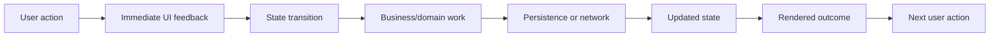

---
# 4. Engineering Goals

A durable Hypercube codebase should optimize for the following engineering outcomes.

### 4.1 Fast interaction

Taps, gestures, route changes, and visible state transitions should respond quickly. UI work should remain proportional to the visible surface.

### 4.2 Clear information architecture

Users should know where they are, what can be changed, and how to return. Route names and screen boundaries should reinforce that mental model.

### 4.3 Reusable primitives

Buttons, cards, typography, loading states, error states, and surfaces should not be independently reimplemented on every screen.

### 4.4 Resilient state

A temporary network problem should not destroy local state. A malformed payload should not crash the entire application. A missing image should have a fallback.

### 4.5 Portable infrastructure

Application logic should remain independent from any one storage provider, API vendor, or native implementation when practical.

### 4.6 Contributor friendliness

A contributor should be able to answer four questions quickly:

1. Where does this screen live?
2. Where does its state live?
3. Which service owns the external interaction?
4. Which test protects the behavior?

---
# 5. Architecture Principles

### Principle 1 — UI is not business logic

Rendering code should describe presentation. Rules such as validation, calculation, mapping, or persistence should live behind explicit boundaries.

```tsx
function FeatureScreen() {
  const model = useFeatureModel();
  return <FeatureView model={model} />;
}
```

### Principle 2 — Side effects live at the edges

Network calls, storage writes, analytics, timers, and native APIs are side effects. Keep them out of pure rendering and pure domain functions.

### Principle 3 — State should have an owner

For every state value, the codebase should make it possible to answer: *who owns this value and who is allowed to update it?*

### Principle 4 — External data is untrusted

Even data returned by a service that the application controls should be treated as a boundary. Validate shape and required fields before the data enters the domain model.

### Principle 5 — Failure is a normal state

Every asynchronous feature should consider loading, success, empty, and failure paths.

### Principle 6 — Measure before optimizing

Performance work should be based on observation. Avoid adding abstractions, memoization, or background work solely because it sounds faster.

---
# 6. System Architecture

The following architecture is a recommended target for a scalable React Native implementation of Hypercube:

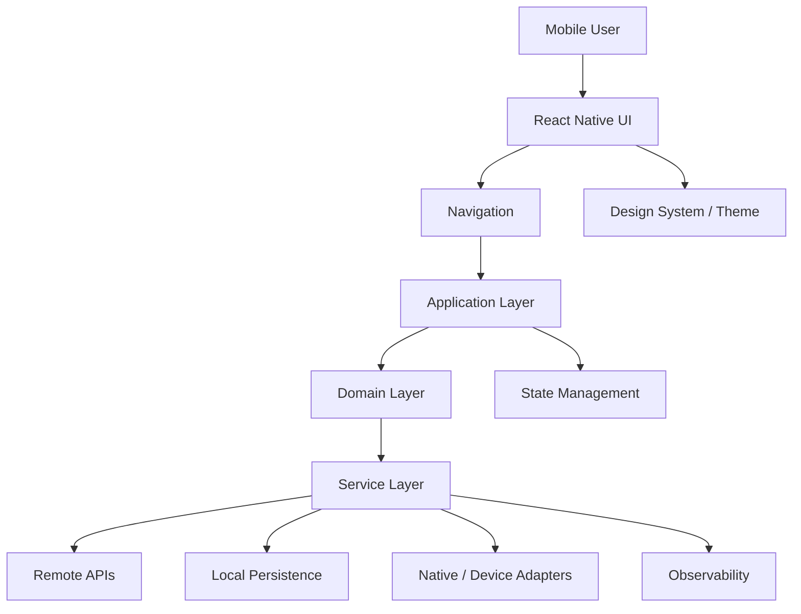

### Layer intent

| Layer | Responsibility |
|---|---|
| UI | Rendering, interaction, accessibility |
| Navigation | Routes, parameters, back-stack semantics |
| Application | Screen orchestration, use-case coordination |
| State | Session, feature, and server-state coordination |
| Domain | Pure rules, validation, transformations |
| Services | APIs, storage, native integrations |
| Infrastructure | Concrete implementations of external dependencies |
| Observability | Diagnostics, metrics, safe logs |

### Dependency direction

Dependencies should move inward toward stable concepts:

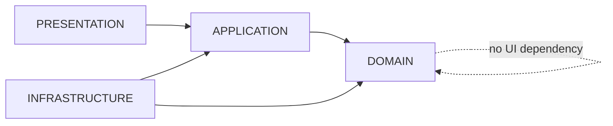

A domain module should not import a screen module merely to perform a calculation.

---
# 7. Application Layers

### Presentation layer

Owns React Native components, layout, typography, and interaction semantics.

### Navigation layer

Owns route registration, route parameters, nested navigators, and deep-link boundaries.

### Application layer

Coordinates user intent. A screen model or hook can combine several domain and service operations into a view-friendly state representation.

### Domain layer

Contains pure rules and transformations. This is the most testable part of the application because it can often be executed without a device, network, or native runtime.

### Infrastructure layer

Contains the concrete implementation of storage, HTTP transport, device capabilities, and third-party SDKs.

### Example dependency flow

```text
Screen
  ↓
View Model / Hook
  ↓
Use Case / Domain Operation
  ↓
Service Interface
  ↓
Infrastructure Adapter
```

This separation is particularly valuable when a feature starts local-only and later needs a remote API.

---
# 8. Navigation Architecture

Navigation is an application contract rather than merely a UI utility.

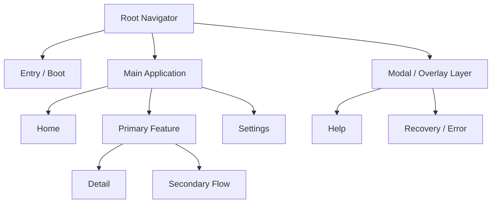

### Route conventions

Use semantic names such as:

```text
Home
PrimaryFeature
PrimaryFeatureDetail
Settings
Help
```

Avoid names that encode temporary implementation details:

```text
Screen1
BluePage
NewScreenV4
TestRoute
```

### Parameter contracts

Use explicit, serializable parameters:

```ts
type DetailRouteParams = {
  id: string;
};
```

Passing a stable identifier is often safer than passing a large mutable object through navigation.

### Navigation failure handling

A missing or invalid route target should resolve to a safe destination or an explicit error surface instead of a hard crash.

---
# 9. State Management

State should be divided by lifetime and ownership.

| State class | Examples | Recommended owner |
|---|---|---|
| Local UI | toggle, text input, accordion | Component |
| Screen | filter, selection, loading | Screen hook/model |
| Session | user, preferences, feature flags | App state |
| Server | fetched records, remote status | Server-state layer |
| Persistent | saved preferences, cache | Storage adapter |

### State machine mindset

Instead of several booleans:

```ts
isLoading
hasError
hasData
isEmpty
```

prefer an explicit state model:

```ts
type AsyncState<T> =
  | { status: 'idle' }
  | { status: 'loading' }
  | { status: 'success'; data: T }
  | { status: 'error'; error: AppError };
```

### State flow

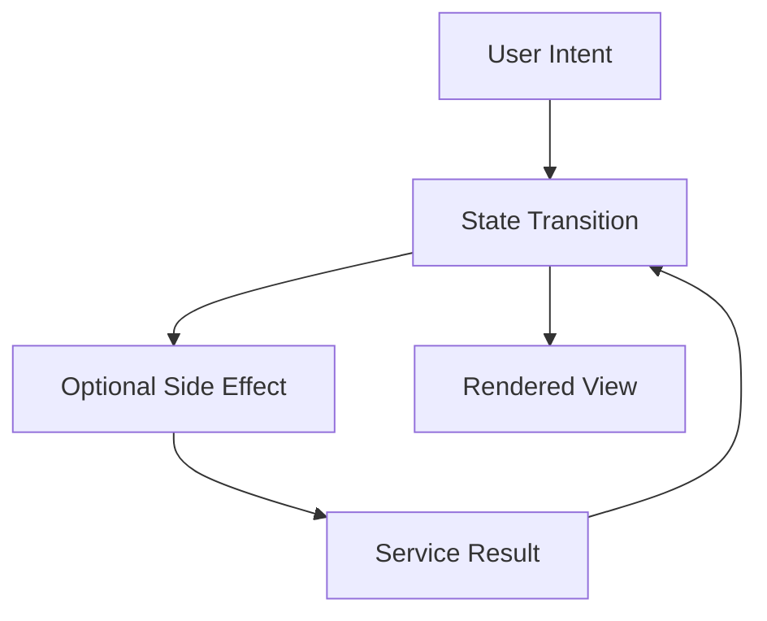

The key is that state transitions remain observable and predictable.

---
# 10. Domain Modeling

The domain layer should use explicit models rather than leaking raw transport objects into the UI.

```ts
export type EntityId = string;

export interface HypercubeEntity {
  id: EntityId;
  title: string;
  description?: string;
  createdAt: string;
  updatedAt: string;
}
```

This sample is architectural guidance rather than a claim about the current app's domain schema.

### DTO → domain → view model

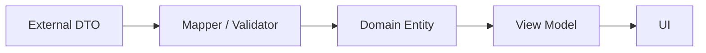

Benefits include:

- API changes stay localized;
- domain types remain stable;
- UI code avoids defensive property checks everywhere;
- tests can work with deterministic fixtures.

### Pure transformations

Prefer functions with no side effects:

```ts
function sortEntities(items: HypercubeEntity[]) {
  return [...items].sort((a, b) => a.title.localeCompare(b.title));
}
```

Pure functions are straightforward to test and reason about.

---
# 11. Service Boundaries

Services are the boundary between product logic and external systems.

```ts
export interface ExampleRepository {
  list(): Promise<HypercubeEntity[]>;
  get(id: string): Promise<HypercubeEntity | null>;
}
```

The application layer should depend on the interface, while infrastructure provides the implementation.

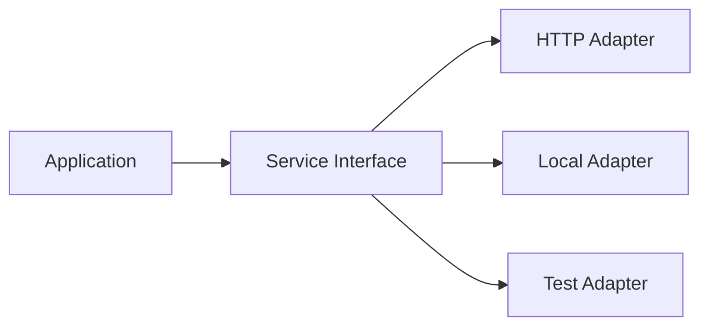

### Why interfaces matter

A feature can start with a local implementation and later move to a remote service without rewriting screen code.

### Service rules

A service should:

- normalize transport errors;
- validate or map external data;
- avoid exposing low-level library types;
- document retry behavior;
- make dependencies explicit.

---
# 12. Persistence

Local persistence should be hidden behind a small interface.

```ts
export interface KeyValueStore {
  get<T>(key: string): Promise<T | null>;
  set<T>(key: string, value: T): Promise<void>;
  remove(key: string): Promise<void>;
}
```

### Hydration lifecycle

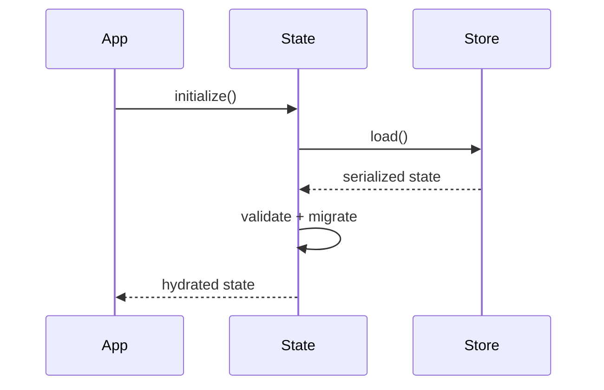

### Versioned storage

Persisted structures should be versioned when the product expects to survive schema changes:

```json
{
  "schemaVersion": 2,
  "preferences": {}
}
```

Migration should be explicit:

```text
v1 → v2 → v3
```

Do not assume that yesterday's persisted record is automatically compatible with today's code.

### Cache policy

A useful cache policy answers three questions:

1. How long is the data valid?
2. What happens when the network is unavailable?
3. Which data can safely be discarded?

---
# 13. Networking

The public root does not document a specific backend or endpoint set. If networking is added or expanded, it should remain behind an API client and service layer.

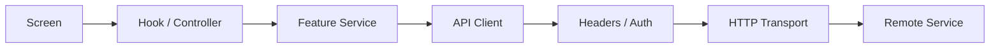

### Error taxonomy

```text
Transport
├── timeout
├── offline
└── connection failure

HTTP
├── 4xx
└── 5xx

Application
├── malformed payload
├── unexpected shape
└── unsupported version
```

### Retry rules

Retry idempotent operations when a transient failure is likely. Do not blindly retry operations whose repeated execution might cause duplicate side effects.

### Request cancellation

Screen-scoped requests should be cancellable where the transport permits it. A component that has already unmounted should not keep producing state updates after it is gone.

---
# 14. Error Handling

Error handling should produce a consistent application-level representation.

```ts
export type AppError = {
  code: string;
  message: string;
  retryable: boolean;
  cause?: unknown;
};
```

### Error boundary strategy

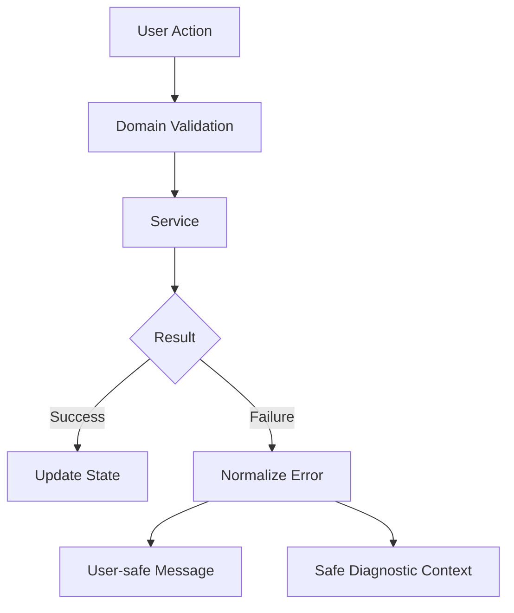

The user-facing message should describe the action the user can take. Technical stack traces belong in developer diagnostics.

### Error copy principles

Prefer:

> Something went wrong while loading this content. Try again.

Over:

> TypeError: Cannot read property `data` of undefined.

### Recovery actions

Where relevant, give the user one clear recovery path:

```text
Retry
Reload
Go back
Continue offline
```

---
# 15. Loading and Empty States

Every data-driven experience should explicitly model four primary states:

```text
Idle
  ↓
Loading
  ↓
Success ──→ Empty
  │
  └──────→ Populated
  ↓
Error
```

### Loading

Use a placeholder that matches the expected content structure when possible. Avoid blocking the entire screen if only a secondary region is loading.

### Empty

An empty state should explain why there is nothing to show and, when possible, provide the next action.

### Error

An error state should not look identical to an empty state. A missing result and a failed request have different meanings.

### Pull-to-refresh / retry

Refreshing should not unnecessarily reset the whole navigation stack. Keep the user's context stable while data updates.

### Reusable pattern

```tsx
function AsyncContent<T>({ state, render }) {
  if (state.status === 'loading') return <LoadingState />;
  if (state.status === 'error') return <ErrorState />;
  if (state.status === 'success' && state.data.length === 0) {
    return <EmptyState />;
  }
  return render(state.data);
}
```

---
# 16. Visual Design System

A shared design system prevents visual drift as the application grows.

### Token categories

```text
Color
Typography
Spacing
Radius
Elevation
Motion
Opacity
Safe areas
```

### Example tokens

```ts
export const spacing = {
  xs: 4,
  sm: 8,
  md: 16,
  lg: 24,
  xl: 32,
} as const;
```

The values above are examples, not a statement of the current Hypercube visual system.

### Semantic color roles

Prefer semantic names:

```text
background
surface
surfaceElevated
textPrimary
textSecondary
border
accent
success
danger
warning
```

This makes theme changes safer than scattering raw hex values throughout the application.

### Typography hierarchy

A useful mobile hierarchy is:

```text
Display
Title
Heading
Body
Caption
Label
```

The exact font family and sizes should follow the real application assets and screenshots.

---
# 17. Asset Pipeline

The repository contains an `images/` directory and two historical screenshots. Those artifacts are valuable for preserving the visual language while the source is modernized.

### Recommended asset layout

```text
assets/
├── icons/
├── illustrations/
├── backgrounds/
├── screenshots/
└── branding/
```

### Asset naming

Prefer semantic names such as:

```text
hypercube-mark.png
feature-header.png
empty-state.png
```

Avoid ambiguous names such as:

```text
IMG_0031.png
final2.png
newnew.png
```

### Image performance

For mobile:

- avoid shipping a huge image when the UI only displays a thumbnail;
- use correct dimensions and compression;
- avoid decoding many full-resolution images at once;
- provide placeholders where remote assets may be missing.

### Screenshot-driven development

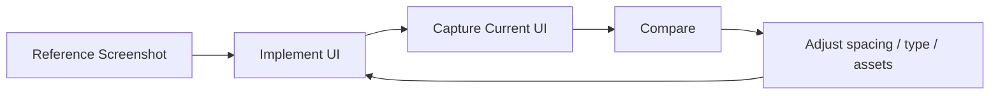

---
# 18. Responsive Layout

A React Native mobile UI should respond to different screen dimensions instead of assuming one fixed phone size.

### Layout rules

Prefer flexbox, safe-area insets, and semantic spacing over fixed absolute placement.

```tsx
const styles = StyleSheet.create({
  screen: {
    flex: 1,
    paddingHorizontal: 20,
  },
});
```

### Responsive flow

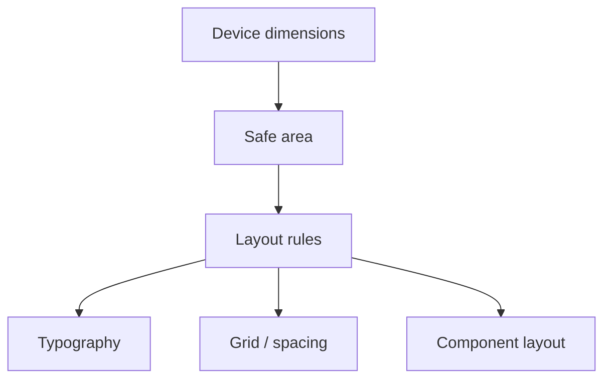

### Orientation

Only support additional orientations when the product actually benefits from them. Each supported orientation should be tested for:

- navigation;
- keyboard behavior;
- image cropping;
- accessibility;
- modal placement;
- safe areas.

---
# 19. Accessibility

Accessibility is a product-quality requirement, not merely a compliance exercise.

### Interactive elements

Every actionable control should communicate:

- role;
- accessible name;
- state;
- enabled/disabled status;
- selected state where relevant.

### Dynamic text

Layouts should tolerate larger text sizes without clipping essential information.

### Color independence

Do not use color as the only signal for success, warning, selection, or error.

### Motion

Animation should support meaning rather than distract from content. Where a transition is nonessential, reduced-motion-friendly behavior should be considered.

### Accessibility test matrix

| Area | Check |
|---|---|
| Buttons | Name + role |
| Inputs | Label + hint |
| Lists | Item semantics |
| Modals | Focus / dismissal behavior |
| Errors | Announced and visible |
| Text | Larger-size resilience |
| Color | Non-color cues |

---
# 20. Performance

React Native performance is influenced by JavaScript work, native work, rendering, images, and network behavior.

### Common bottlenecks

- unnecessary component re-renders;
- expensive list items;
- oversized images;
- repeated state derivation;
- unbounded effects;
- synchronous work during launch;
- repeated network fetches;
- listeners that are not cleaned up.

### Rendering rule

Only optimize after identifying a real bottleneck.

### Lists

For large collections, use virtualized lists rather than eagerly rendering every item.

### Memoization

Memoization is useful when it prevents measurable work. It should not be applied mechanically to every component.

### Performance flow

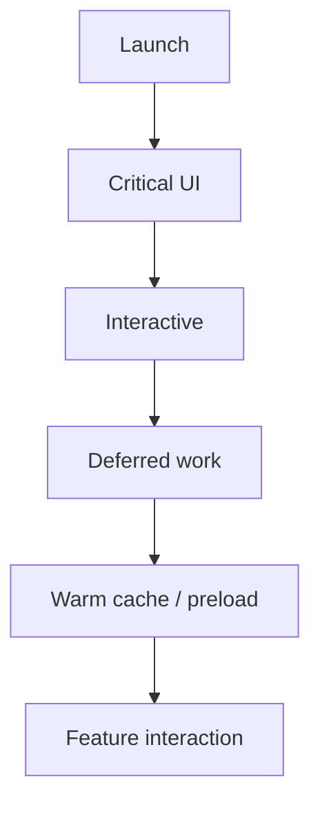

### Long-session stability

Check for:

- timers without cleanup;
- event listeners without cleanup;
- repeated subscriptions;
- retained navigation objects;
- image cache growth;
- repeated polling.

---
# 21. Security

A mobile bundle should be treated as inspectable by the person who installs it. Therefore secrets must not be embedded in JavaScript source or committed configuration.

### Never ship as a secret

```text
private keys
service-account secrets
production passwords
long-lived admin tokens
```

### Boundary validation

Validate external input before it reaches business logic.

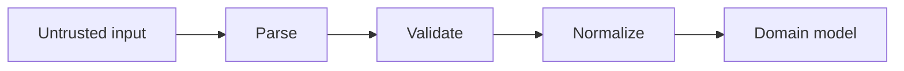

### Logging safety

Do not log access tokens, refresh tokens, passwords, or sensitive user content by default.

### Dependency hygiene

Keep third-party dependencies reviewed. Prefer maintained packages with clear release histories and avoid unnecessary native dependencies when a pure-JS solution is sufficient for the actual use case.

---
# 22. Privacy

Privacy engineering starts with data minimization.

### Data classification

A useful classification is:

```text
Essential
Optional
Diagnostics
Analytics
Sensitive
```

For each stored or transmitted field, document:

1. why it exists;
2. where it is stored;
3. how long it persists;
4. whether it leaves the device;
5. who can access it.

### Local-first strategy

When computation can safely happen on-device, local processing can reduce unnecessary network transfer.

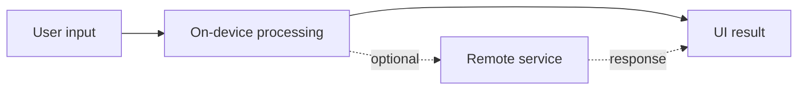

### Privacy-by-default

Start with the smallest amount of data needed for the feature and add more only when the requirement is explicit.

---
# 23. Observability

Observability gives maintainers visibility into problems that do not reproduce on a development machine.

### Structured events

Prefer structured diagnostics:

```json
{
  "event": "feature_opened",
  "screen": "FeatureScreen",
  "appVersion": "example"
}
```

The structure should remain free of secrets and unnecessary personal information.

### Useful context

When safe, diagnostics may include:

```text
feature
screen
operation
error code
platform
application version
```

### Logging levels

```text
debug
info
warn
error
```

Verbose development logs should not automatically become production logs.

### Failure telemetry flow

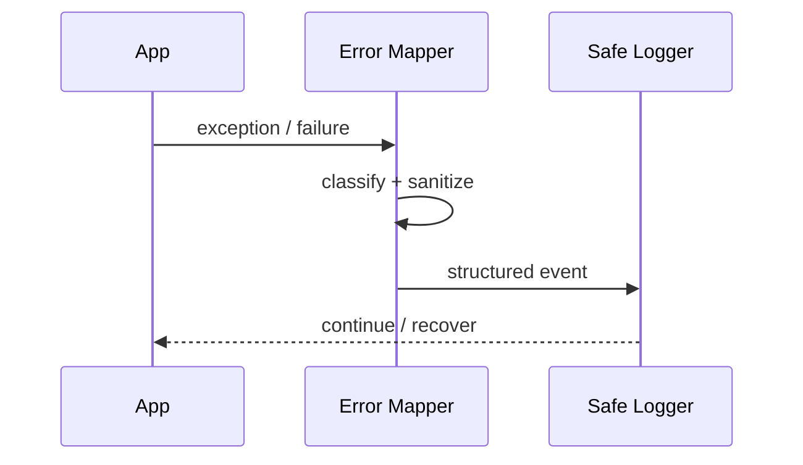

---
# 24. Testing Strategy

A strong testing strategy is layered.

### Unit tests

Test pure rules, validation, transformations, reducers, and utility functions.

### Component tests

Test rendering and interaction of individual UI units.

### Integration tests

Test screen-to-service behavior using controlled adapters or mocks.

### End-to-end tests

Reserve E2E tests for the most important journeys because they are slower and more environment-sensitive.

### Testing pyramid

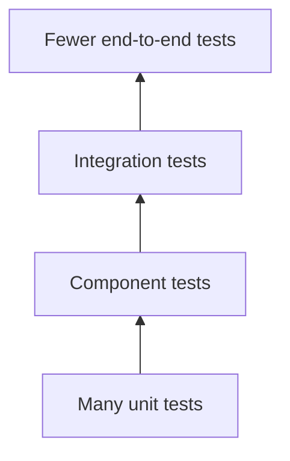

### Recommended high-value scenarios

```text
Launch
Navigate to primary feature
Perform primary action
Handle empty data
Handle network failure
Restore persisted state
Recover from malformed state
```

### Test data

Use deterministic fixtures. A fixture should describe a scenario, not reproduce a whole production database.

---
# 25. Developer Setup

The root repository currently stores the mobile application source in `hypercube-mobile.zip`. The safest setup process is therefore to extract the project first and then follow the package manifest and native configuration found inside that source.

### Clone

```bash
git clone https://github.com/lucylow/Hypercube.git
cd Hypercube
```

### Inspect the root

```bash
ls -la
```

### Extract the mobile project

macOS / Linux:

```bash
unzip hypercube-mobile.zip -d hypercube-mobile
```

Windows PowerShell:

```powershell
Expand-Archive hypercube-mobile.zip -DestinationPath hypercube-mobile
```

### Inspect the extracted project

```bash
cd hypercube-mobile
ls -la
```

Look for the actual project manifest and configuration files before installing dependencies. Typical examples in React Native projects can include:

```text
package.json
app.json / app.config.*
babel.config.*
metro.config.*
tsconfig.json
android/
ios/
```

These are examples, not a claim that every file exists in the archived project.

### Why exact commands are intentionally not hard-coded

React Native projects differ by generation and toolchain. The correct Node version, package manager, platform tooling, and run scripts should be inferred from the actual extracted source instead of being fabricated in documentation.

---
# 26. Repository Workflow

Use small, reviewable changes.

### Suggested branches

```text
main
├── feature/*
├── fix/*
├── refactor/*
└── docs/*
```

### Suggested commit style

```text
feat: add feature detail flow
fix: prevent duplicate refresh
refactor: isolate persistence adapter
test: cover loading failure state
docs: document navigation architecture
```

### One concern per pull request

Avoid bundling an unrelated dependency migration, navigation rewrite, formatting sweep, and feature addition into the same change.

### Change workflow

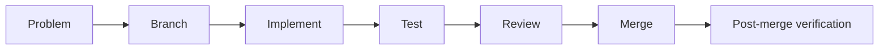

---
# 27. Debugging

### Blank screen

Check the following in order:

1. JavaScript runtime errors.
2. Root component rendering.
3. Navigation initialization.
4. Asset imports.
5. Native initialization.
6. Unexpected async work during startup.

### State resets unexpectedly

Investigate:

```text
component remounts
navigation keys
provider placement
persistence hydration
app lifecycle handlers
```

### Network loop

Look for effects whose dependency list changes on every render:

```tsx
useEffect(() => {
  refresh();
}, [unstableObject]);
```

Use stable dependencies and explicit refresh triggers.

### Native build failure

Capture:

```text
platform
OS version
Node version
package manager
native toolchain version
exact error
clean-build result
```

Then reproduce from a clean checkout.

### Debugging checklist

```text
[ ] Can the problem be reproduced?
[ ] Is it platform-specific?
[ ] Is it deterministic?
[ ] Did it begin after a dependency change?
[ ] Does it survive a clean build?
[ ] Is there a useful error boundary?
```

---
# 28. Release Engineering

A mobile release should be repeatable.

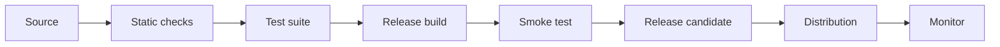

### Release metadata

Record:

```text
version
build number
release date
notable changes
known issues
```

### Release notes

A release note should explain the user-visible impact rather than only internal file changes.

### Rollback readiness

A release process should know how to stop distributing a broken build and how to identify the previous known-good version.

---
# 29. CI/CD

The public repository currently exposes no detailed release automation in the root listing. A future CI pipeline can progressively add confidence without making the workflow unnecessarily complex.

### Suggested pipeline

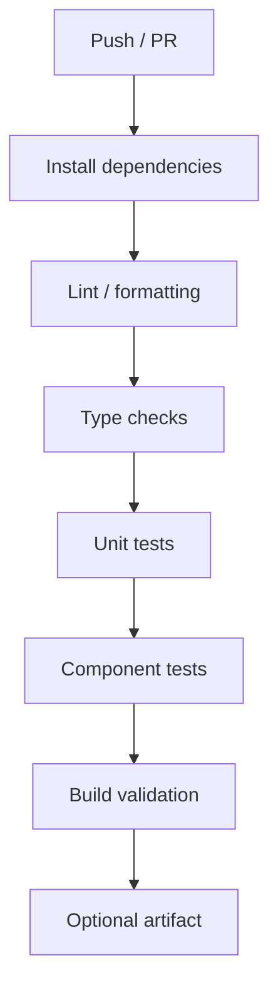

### Pipeline stages

**Fast checks:** formatting, lint, type checks.  
**Behavior checks:** unit/component tests.  
**Build checks:** platform build where CI capacity permits.  
**Release checks:** signing, versioning, artifact publication.

### CI principles

- keep the fast path fast;
- fail clearly;
- cache dependency installation carefully;
- never print secrets;
- make release jobs explicit rather than automatic by accident.

---
# 30. Architecture Evolution

Avoid rewriting the entire app simply because a more sophisticated architecture exists.

### Evolution rule

Start with the smallest boundary that solves the problem.

```text
Screen
  ↓
Hook
  ↓
Service
```

Extract additional layers after repeated patterns emerge.

### Architecture smell indicators

Consider a refactor when:

- screens contain unrelated data access;
- the same transformation is copied in multiple files;
- tests require mounting half the application to validate one rule;
- a change to one API payload forces edits across many screens;
- navigation parameters contain large mutable objects;
- persistence details leak into UI components.

### Refactoring loop

```mermaid
flowchart LR
    OBSERVE[Observe pain] --> ISOLATE[Identify boundary]
    ISOLATE --> EXTRACT[Extract smallest abstraction]
    EXTRACT --> TEST[Protect behavior]
    TEST --> MEASURE[Measure improvement]
```

---
# 31. Feature Module Template

A scalable feature can be organized as:

```text
src/features/example/
├── components/
│   └── ExampleCard.tsx
├── screens/
│   └── ExampleScreen.tsx
├── hooks/
│   └── useExample.ts
├── services/
│   └── exampleService.ts
├── state/
│   ├── exampleState.ts
│   └── exampleReducer.ts
├── types/
│   └── example.types.ts
└── index.ts
```

### Feature dependency graph

```mermaid
flowchart LR
    SCREEN[ExampleScreen] --> HOOK[useExample]
    SCREEN --> COMPONENT[ExampleCard]
    HOOK --> SERVICE[exampleService]
    HOOK --> TYPES[example.types]
    SERVICE --> TYPES
    COMPONENT --> TYPES
```

### Feature contract

Each major feature should document:

```text
Purpose
Entry points
Inputs
State
External dependencies
Primary actions
Loading behavior
Empty behavior
Failure behavior
Accessibility
Performance notes
Tests
```

### Public feature surface

A feature should expose only what other modules need. Keep internal helpers private to the feature wherever possible.

---
# 32. Technical Diagrams

### 32.1 End-to-end application flow

```mermaid
flowchart TB
    USER[User]
    USER --> SCREEN[React Native screen]
    SCREEN --> STATE[Application state]
    STATE --> DOMAIN[Domain operation]
    DOMAIN --> SERVICE[Service]
    SERVICE --> EXT[API / Storage / Native]
    EXT --> SERVICE
    SERVICE --> STATE
    STATE --> SCREEN
```

### 32.2 Offline-aware flow

```mermaid
flowchart TD
    OPEN[Open feature] --> CACHE{Cached state?}
    CACHE -->|yes| SHOW[Show cached UI]
    CACHE -->|no| LOAD[Show loading]
    SHOW --> REFRESH[Background refresh]
    LOAD --> REQUEST[Request]
    REFRESH --> REQUEST
    REQUEST --> RESULT{Success?}
    RESULT -->|yes| UPDATE[Update cache + UI]
    RESULT -->|no| RETRY[Retry / error UI]
```

### 32.3 Authentication boundary (future capability)

```mermaid
sequenceDiagram
    participant UI
    participant Session
    participant API
    participant Server

    UI->>Session: request authenticated action
    Session->>API: attach access context
    API->>Server: secure request
    Server-->>API: response
    API-->>Session: normalized result
    Session-->>UI: state update
```

This is an architectural pattern only; it is not a claim that the current public repository has authentication.

### 32.4 Event flow

```mermaid
flowchart LR
    TAP[Tap / gesture] --> INTENT[Intent]
    INTENT --> REDUCER[State transition]
    REDUCER --> SIDE[Optional effect]
    SIDE --> RESULT[Result]
    RESULT --> REDUCER
    REDUCER --> RENDER[Render]
```

### 32.5 Mobile lifecycle

```mermaid
stateDiagram-v2
    [*] --> Booting
    Booting --> Hydrating
    Hydrating --> Ready
    Ready --> Background
    Background --> Ready
    Ready --> Inactive
    Inactive --> Ready
    Ready --> Terminating
    Terminating --> [*]
```

### 32.6 Dependency boundary

```text
┌────────────────────────────────────────┐
│              Presentation              │
│ screens • components • theme • a11y   │
└───────────────────┬────────────────────┘
                    │
                    ▼
┌────────────────────────────────────────┐
│             Application Layer           │
│ orchestration • use-cases • state      │
└───────────────────┬────────────────────┘
                    │
                    ▼
┌────────────────────────────────────────┐
│                Domain                  │
│ rules • validation • transformations   │
└───────────────────┬────────────────────┘
                    │
                    ▼
┌────────────────────────────────────────┐
│             Infrastructure             │
│ api • storage • native • telemetry     │
└────────────────────────────────────────┘
```

---
# 33. Performance Budget

Performance budgets are targets, not current measurements.

| Area | Suggested goal |
|---|---|
| Initial interaction | User can interact as early as practical |
| Navigation | No avoidable blocking work |
| Lists | Virtualized for large datasets |
| Images | Decode only what the viewport requires |
| Network | Bounded retries and timeouts |
| Memory | Stable during long sessions |
| Animations | Smooth under normal interaction |

### Performance review questions

Before merging a large feature:

```text
Does it add a heavy dependency?
Does it increase launch work?
Does it increase image memory?
Does it trigger extra renders?
Does it create a long-lived listener?
Does it add a blocking network request?
Does it duplicate existing cache data?
```

### Profiling loop

```mermaid
flowchart LR
    REPRODUCE[Reproduce] --> MEASURE[Measure]
    MEASURE --> HYPOTHESIS[Hypothesis]
    HYPOTHESIS --> CHANGE[Small change]
    CHANGE --> MEASURE2[Measure again]
    MEASURE2 --> DECIDE{Improved?}
    DECIDE -->|yes| KEEP[Keep]
    DECIDE -->|no| REVERT[Revert / rethink]
```

---
# 34. Threat Model

A lightweight threat model makes security assumptions explicit.

### Assets

Potentially sensitive assets include:

```text
session identifiers
local user data
application configuration
cached remote records
third-party credentials
analytics payloads
```

### Threats

```mermaid
flowchart TD
    T[Threat sources]
    T --> A[Malicious input]
    T --> B[Compromised dependency]
    T --> C[Untrusted network]
    T --> D[Device loss]
    T --> E[Reverse engineering]
```

### Mitigation map

| Threat | Example mitigation |
|---|---|
| Malicious input | Validation + normalization |
| Dependency compromise | Dependency review + lockfile discipline |
| Network attack | Secure transport + certificate/platform controls |
| Device loss | Minimize sensitive local persistence |
| Reverse engineering | Keep secrets off-device and use server-side authorization |

### Least privilege

Every external integration should receive only the permissions it needs. Avoid broad device permissions when a narrow capability is sufficient.

---
# 35. Failure Modes

### Failure mode A — Network unavailable

Preferred behavior:

```text
Use valid cached data when available.
Explain that refresh failed.
Offer retry.
Preserve navigation context.
```

### Failure mode B — Corrupt local state

Preferred behavior:

```text
Detect invalid shape.
Discard only the affected record.
Restore defaults.
Record safe diagnostics.
```

### Failure mode C — Missing asset

Preferred behavior:

```text
Render placeholder.
Keep surrounding layout stable.
Log a safe asset-miss event during development.
```

### Failure mode D — Slow device

Preferred behavior:

```text
Prioritize visible UI.
Defer noncritical work.
Use bounded lists.
Avoid large synchronous transforms.
```

### Failure mode E — Unexpected service response

Preferred behavior:

```mermaid
flowchart LR
    RESPONSE[Response] --> VALIDATE[Validate shape]
    VALIDATE -->|valid| MAP[Map to domain]
    VALIDATE -->|invalid| ERROR[Normalized error]
    ERROR --> RETRY[Retry / fallback if safe]
```

---
# 36. Contribution Guide

Contributors should preserve behavior before refactoring structure.

### Before coding

Read the relevant screen, service, state owner, and tests. Reproduce the existing behavior first.

### During coding

Prefer a small change with a clear responsibility. Add tests for domain rules and important asynchronous states.

### Before pull request

```text
[ ] Formatting passes
[ ] Types pass
[ ] Tests pass
[ ] Navigation checked
[ ] Accessibility checked
[ ] Loading/error states checked
[ ] No secret values added
[ ] README updated if behavior changed
```

### Pull request template

```md
## Problem
What problem does this change solve?

## Solution
What changed?

## Validation
How was it tested?

## Screenshots
Include before/after visuals for UI changes.

## Known limitations
What remains intentionally out of scope?
```

---
# 37. Code Review Checklist

### Architecture

- [ ] UI and business logic have a sensible separation.
- [ ] External dependencies remain behind appropriate boundaries.
- [ ] Types are explicit where they provide meaningful safety.
- [ ] State ownership is clear.
- [ ] Navigation parameters are stable.

### UX

- [ ] Loading state exists where needed.
- [ ] Empty state exists where needed.
- [ ] Failure state exists where needed.
- [ ] Retry/recovery behavior is sensible.
- [ ] Back navigation works.

### Performance

- [ ] No obvious render loop.
- [ ] Large collections are handled appropriately.
- [ ] Images are reasonably sized.
- [ ] Expensive work is not repeated without reason.

### Security and privacy

- [ ] No secrets are committed.
- [ ] External payloads are validated.
- [ ] Logs do not contain sensitive information.

### Accessibility

- [ ] Interactive controls have names and roles.
- [ ] Larger text remains usable.
- [ ] Visual status is not communicated through color alone.

---
# 38. Documentation Standards

Documentation should answer three questions:

### What?

What does this module or feature do?

### Why?

Why does the code exist in this form?

### How?

How should another developer use or modify it?

### Comment decisions, not syntax

Bad:

```ts
// increment counter
counter += 1;
```

Better:

```ts
// Preserve the server cursor so pull-to-refresh does not restart pagination.
cursor = cachedCursor;
```

### Architecture Decision Records

For major choices, consider:

```text
docs/adr/
├── 001-navigation.md
├── 002-persistence.md
├── 003-networking.md
└── 004-observability.md
```

An ADR should record the context, decision, consequences, and alternatives considered.

---
# 39. Suggested Modernization Plan

If the goal is to evolve the repository into a conventional maintainable application, use incremental stages.

### Stage 1 — Preserve

```text
Extract archive
↓
Run original application
↓
Capture current behavior
↓
Record dependencies
```

### Stage 2 — Normalize

```text
Promote source tree
↓
Add reliable package metadata
↓
Document run commands
↓
Document platform requirements
```

### Stage 3 — Stabilize

```text
Add error states
↓
Add loading / empty states
↓
Add explicit domain types
↓
Add tests for critical flows
```

### Stage 4 — Modularize

```text
Feature folders
↓
Service boundaries
↓
Persistence adapter
↓
Design tokens
```

### Stage 5 — Productionize

```text
CI
↓
Release process
↓
Observability
↓
Security review
↓
Performance review
```

### Golden rule

Do not combine all five stages into one rewrite. Each stage should leave the application working.

---
# 40. Future Roadmap

The roadmap below is intentionally future-facing.

### Phase A — Repository modernization

- expand the root README;
- document source archive contents;
- establish reproducible local setup;
- promote the mobile source tree into a standard layout if desired.

### Phase B — Design system

- semantic tokens;
- reusable surfaces;
- shared buttons and controls;
- accessibility baseline;
- screenshot-driven regression checks.

### Phase C — Architecture

- explicit feature boundaries;
- domain models;
- service interfaces;
- persistence adapter;
- normalized errors.

### Phase D — Quality

- unit tests;
- component tests;
- integration tests;
- critical-path end-to-end checks;
- performance measurement.

### Phase E — Operations

- CI checks;
- release automation;
- crash diagnostics;
- dependency audits;
- documented rollback strategy.

### Long-term direction

A mature Hypercube repository should make the following possible without architectural surgery:

```text
new feature
new storage strategy
new API implementation
new native adapter
new theme
new test suite
new release channel
```

---
# 41. FAQ

### Is Hypercube a React Native project?

Yes. The public GitHub repository describes it as a React Native Mobile App.

### What is in the public root today?

The repository currently exposes `images/`, `.gitignore`, `LICENSE`, `README.md`, two historical screenshots, and `hypercube-mobile.zip`.

### Where is the application source?

The mobile source is packaged in `hypercube-mobile.zip` at the repository root.

### What license is used?

The repository includes an MIT license.

### Does this README claim that all recommended architecture is already implemented?

No. Recommended patterns are clearly presented as guidance or future work when they cannot be verified from the public repository root.

### What is the safest development workflow?

Inspect the archive, verify the original build, preserve existing behavior, then modernize incrementally.

### Why are exact npm commands not included?

Because the public root does not expose the archived project's package manifest and toolchain. Exact commands should come from the actual extracted source rather than from assumptions.

---
# 42. Glossary

**Adapter** — A concrete implementation that translates an abstract service interface into a particular technology.

**API client** — Shared transport code for remote requests.

**Domain model** — A typed representation of a concept meaningful to application rules.

**DTO** — Data Transfer Object used at a transport boundary.

**Hydration** — Restoring application state from persistence.

**Memoization** — Caching the result of a computation to avoid repeating work.

**Navigation state** — The route hierarchy and back-stack state.

**Persistence** — Saving state so it survives process restarts.

**Screen model** — A presentation-oriented state and action layer for a screen.

**Service layer** — Boundary around external systems such as HTTP, storage, and native APIs.

**View model** — Data shaped for easy consumption by the UI.

---
# 43. License

The repository includes an **MIT License**.

For the authoritative text, see [`LICENSE`](LICENSE) in the repository.

```text
MIT License

Permission is hereby granted, free of charge, to any person obtaining a copy
of this software and associated documentation files, to deal in the Software
without restriction, including without limitation the rights to use, copy,
modify, merge, publish, distribute, sublicense, and/or sell copies of the
Software, and to permit persons to whom the Software is furnished to do so,
subject to the conditions of the MIT License.

THE SOFTWARE IS PROVIDED "AS IS", WITHOUT WARRANTY OF ANY KIND, EXPRESS OR
IMPLIED, INCLUDING BUT NOT LIMITED TO THE WARRANTIES OF MERCHANTABILITY,
FITNESS FOR A PARTICULAR PURPOSE AND NONINFRINGEMENT.
```

---
# 44. Acknowledgements

Hypercube is maintained in the public [`lucylow/Hypercube`](https://github.com/lucylow/Hypercube) repository.

The current repository includes:

- a React Native mobile application snapshot;
- image assets;
- historical screenshots dated October 30, 2022;
- the packaged `hypercube-mobile.zip` source archive;
- MIT licensing information.

This README is intended to make that compact repository easier to understand, preserve, and evolve.

---
# Appendix A — Recommended Target Repository Layout

```text
Hypercube/
├── .github/
│   ├── ISSUE_TEMPLATE/
│   ├── workflows/
│   └── pull_request_template.md
├── assets/
│   ├── icons/
│   ├── images/
│   └── screenshots/
├── docs/
│   ├── architecture/
│   ├── adr/
│   ├── product/
│   └── release/
├── src/
│   ├── app/
│   ├── components/
│   ├── features/
│   ├── hooks/
│   ├── navigation/
│   ├── services/
│   ├── state/
│   ├── theme/
│   ├── types/
│   └── utils/
├── tests/
│   ├── unit/
│   ├── component/
│   ├── integration/
│   └── e2e/
├── android/
├── ios/
├── package.json
├── README.md
└── LICENSE
```

This is a **target architecture**, not the current public root tree.

---
# Appendix B — Screen Contract

Each major screen should have a small written contract:

```text
Purpose
Entry point
Inputs
State
External dependencies
Primary actions
Secondary actions
Loading behavior
Empty behavior
Error behavior
Accessibility
Analytics / diagnostics
Performance notes
```

A screen contract makes future refactors safer because contributors can distinguish a behavior change from an internal implementation change.

---
# Appendix C — Service Contract Template

```ts
export interface FeatureService {
  list(input?: ListInput): Promise<FeatureItem[]>;
  get(id: string): Promise<FeatureItem | null>;
  refresh(): Promise<FeatureItem[]>;
}
```

Implementation-specific details should remain outside the UI.

```mermaid
flowchart LR
    VIEW[View] --> PORT[FeatureService]
    PORT --> REMOTE[Remote implementation]
    PORT --> LOCAL[Local implementation]
    PORT --> TEST[Test implementation]
```

---
# Appendix D — State Transition Reference

```mermaid
stateDiagram-v2
    [*] --> Idle
    Idle --> Loading: request
    Loading --> Success: response
    Loading --> Error: failure
    Success --> Loading: refresh
    Error --> Loading: retry
    Success --> Idle: clear
    Error --> Idle: dismiss
```

This state machine is a reference pattern. Feature-specific states may be simpler or more detailed.

---
# Appendix E — Architecture Maturity Model

```mermaid
flowchart LR
    A[Prototype] --> B[Structured App]
    B --> C[Maintainable Product]
    C --> D[Production System]
```

### Prototype

The application works and the UI is recognizable, but boundaries may be informal.

### Structured App

Navigation, components, state, and services have clearer ownership.

### Maintainable Product

Tests, error normalization, accessibility, observability, and performance practices are established.

### Production System

CI/CD, release operations, security controls, migration strategies, and monitoring are repeatable.

---
# Appendix F — Maintainer Checklist

```text
[ ] Source archive inspected
[ ] Original build verified
[ ] Existing UI behavior captured
[ ] Dependency versions documented
[ ] Screen map documented
[ ] Navigation contracts documented
[ ] State ownership documented
[ ] External boundaries documented
[ ] Loading states covered
[ ] Error states covered
[ ] Empty states covered
[ ] Accessibility reviewed
[ ] Performance reviewed
[ ] Sensitive data excluded from logs
[ ] Release process documented
[ ] README kept current
```

---
# Appendix G — One-Page Architecture Summary

```text
                         ┌───────────────────────┐
                         │     Mobile User       │
                         └───────────┬───────────┘
                                     │
                                     ▼
                         ┌───────────────────────┐
                         │   React Native UI     │
                         │ screens/components    │
                         └───────────┬───────────┘
                                     │
                                     ▼
                         ┌───────────────────────┐
                         │ Navigation + State    │
                         │ screen orchestration  │
                         └───────────┬───────────┘
                                     │
                                     ▼
                         ┌───────────────────────┐
                         │ Domain / Application  │
                         │ rules + transforms    │
                         └───────┬───────┬───────┘
                                 │       │
                      ┌──────────┘       └──────────┐
                      ▼                             ▼
             ┌──────────────────┐          ┌──────────────────┐
             │ Local Persistence│          │ Service Layer    │
             │ cache/session    │          │ APIs/native      │
             └──────────────────┘          └────────┬─────────┘
                                                     │
                                                     ▼
                                          ┌──────────────────┐
                                          │ External Systems │
                                          └──────────────────┘
```

---
# Appendix H — Final Engineering Rules

1. **Preserve first, refactor second.**
2. **Keep UI concerns in UI modules.**
3. **Keep external side effects behind boundaries.**
4. **Give every state value an owner.**
5. **Treat every external payload as untrusted.**
6. **Model loading, success, empty, and failure states.**
7. **Measure performance before optimizing.**
8. **Do not store secrets in a mobile bundle.**
9. **Test pure logic heavily and critical journeys end-to-end.**
10. **Document what is true today and label proposals as proposals.**

A successful Hypercube modernization is not a rewrite for its own sake. It is a sequence of small changes that make the next change easier.

---
# Repository Reference

**GitHub:** https://github.com/lucylow/Hypercube  
**Type:** React Native Mobile App  
**License:** MIT  
**Packaged source:** `hypercube-mobile.zip`

> Last documentation principle: this README should evolve whenever the implementation changes. The source of truth for exact build commands, dependencies, native requirements, and feature behavior remains the actual project code and configuration inside the mobile source.
